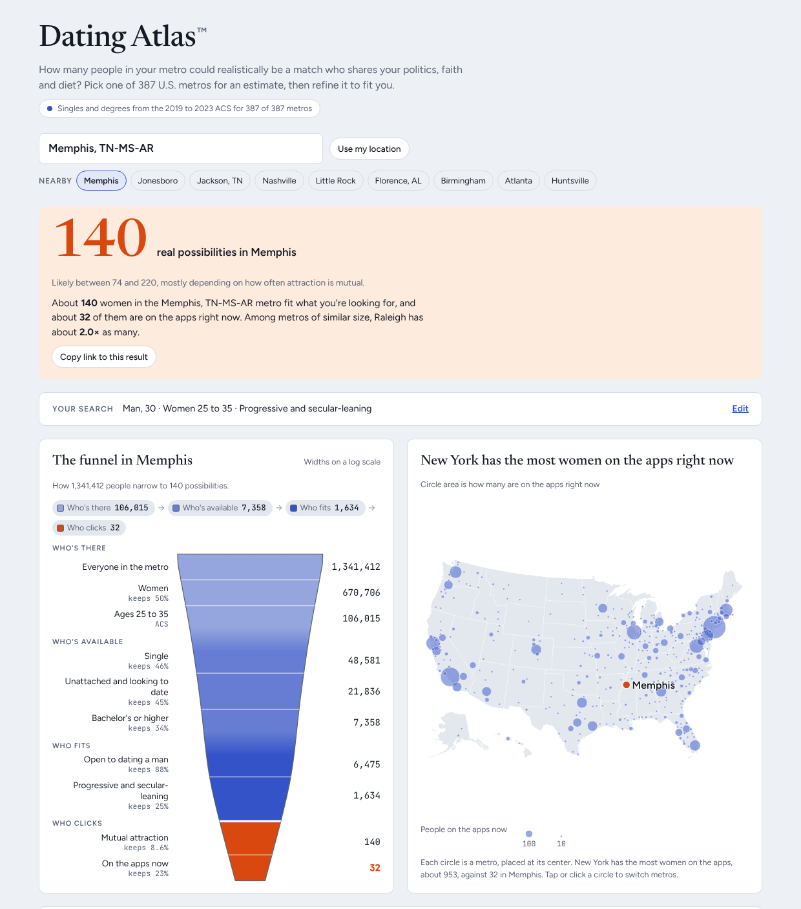
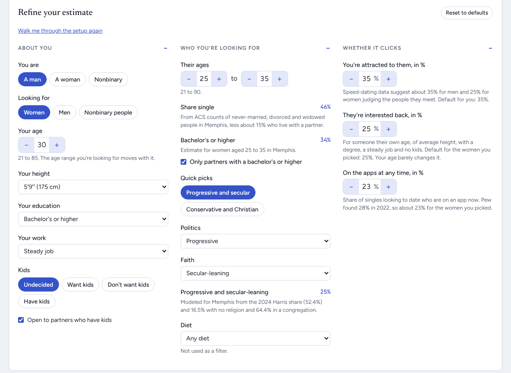

# Dating Atlas™

Dating Atlas estimates how many people in a U.S. metro could realistically be your match, and compares that number across all 387 metro areas. It is a single web page and one data file, with no server.

Live page: https://datingatlas.dev/



## What it does

You pick a metro and say who you are and who you're looking for. The page then shows:

- your number of real possibilities, with an 80% range and a note on which inputs make it uncertain
- a funnel of how the metro's population narrows: people of the genders you date, in your age range, single, looking, with a degree, open to dating you, sharing your politics, faith and diet, compatible on kids, and mutually attracted
- a map of every metro, with circles sized by how many of your possibilities are on dating apps right now
- a ranked list you can sort by number of possibilities, competition, gender balance or rent
- how many people are looking for the same partners as you, and what a 1-bedroom costs as a share of local pay

You can filter by politics (one or more of progressive, liberal, moderate, conservative, very conservative and not political, or any), faith (one or more of non-religious, atheist, agnostic, nothing in particular, Christian, Catholic, Protestant, Latter-day Saint, other Christian, Jewish, Muslim, Hindu, Buddhist and Pagan or Wiccan, or any) and diet (vegetarian, vegan, pescatarian, kosher, halal or any). Your age, height, education, work and kids plans change how interested people are likely to be. Two quick picks set the default profile (progressive, liberal or moderate, non-religious) or the opposite one (moderate, conservative or very conservative, Christian).



On a first visit, a three-step setup asks who you are, who you're looking for and where, then shows the result. The result shows the funnel, the map, the scatter plot and the key numbers in a 2×2 grid, with your search summarized in a bar you can open to edit. The ranked list and the methods open when you ask for them. The page saves your settings in your browser and in its address, so a copied link reopens the same result and skips the setup.

## Repository layout

```
atlas/index.html          the whole page: HTML, CSS and the funnel code
atlas/data.js             every metro's data, as JS constants with one metro per line
data/                     CSV extracts the data in atlas/data.js is built from
docs/                     research notes and the screenshot above
scripts/                  scripts that rebuild atlas/data.js (one per constant, below)
scripts/structure/        checks of how the funnel is built, against survey microdata
scripts/structure/out/    their results, as JSON
.github/workflows/        publishes atlas/ to GitHub Pages
```

There is no build step. Each data script rewrites one JS constant (`ACS`, `PUMS`, `REL`, ...) in `atlas/data.js`, which the page loads before its own script, and the page computes everything else in the browser. Per-metro data sits one metro per line, so a diff of a data update shows which metros changed.

## How the estimate works

### Where each funnel step's data comes from

The funnel runs once for each gender you're looking for and adds them up (`pool()` in `atlas/index.html`). Each step multiplies the count before it by a share. Steps marked *local* differ by metro; the rest use national rates.

| # | Funnel step | Data | Built by | In the page |
|---|---|---|---|---|
| 1 | Population | Census Bureau 2025 estimates for the 387 MSAs (2023 definitions), via Wikipedia's metro list. *Local* | `data/metro_raw.csv` → `raw_to_json.py` | `RAW` (pop) |
| 2 | Your genders | Fixed shares: women 50%, men 48.5%, nonbinary 1.5% | none | `G` |
| 3 | In your age range | ACS 2019–2023 B12002 totals by sex and age band. *Local* | `pull_acs.R` → `acs_to_json.py` | `ACS.metros[...].wt/mt` |
| 4 | Single, not living with a partner | ACS B12002 never married, divorced or widowed (*local*), times the share of singles not cohabiting by sex and age band from 2023 PUMS (national) | `pull_acs.R` → `acs_to_json.py`; `pums_singles.py` | `ACS.metros[...].w/m`, `PUMS.free` |
| 5 | Looking to date | Pew 2022: 20% of singles are in a committed relationship; Pew 2019 share looking, by sex and under/over 40, scaled to 2022; from 65, times 16/36 (Pew 2022: 16% of unpartnered adults 65+ looking against 36% at 50 to 64) | none (constants) | `COMMITTED`, `LOOKING`, `LOOK_65`, `lookRate()`, `lookFit()` |
| 6 | Has a degree (optional) | ACS B15001 degree share by sex and age band (*local*), times how often singles hold degrees against everyone (PUMS, national) | `acs_to_json.py`; `pums_singles.py` | `ACS.metros[...].dw/dm`, `PUMS.deg`, `degParts()` |
| 7 | Open to dating your gender | Gallup orientation rates | none | `OPEN` |
| 8 | Shares your politics and faith | 2024 Harris share by county summed to metros (tonmcg); PRRI county religion estimates and the 2020 U.S. Religion Census; politics groups, their degree shifts and their odds ratios with faith from the 2024 CES. *Local* | `raw_to_json.py`, `religion_to_json.py`, `faith_to_json.py`; `structure/ces_politics.py` for the `POL_*` constants and `NONE_SPLIT` | `RAW` (dem), `REL`, `FAITH`, `POL_FIT`, `POL_OR`, `NONE_SPLIT`, `polShares()`, `valRaw()` |
| 9 | Shares your diet | Gallup 2023, NHANES, Pew 2020 (kosher), ISPU 2022 (halal); kosher and halal scale by the local Jewish or Muslim share | none | `DIET_RATE`, `DIET_POL`, `KOSHER`, `HALAL`, `dietFit()` |
| 10 | Compatible on kids | ACS B11012 single parents (*local*); Pew 2019, 2023 and 2024 on wanting kids and dating parents | `acs_to_json.py` | `ACS.metros[...].kw/km`, `WANT`, `PARENT_NO`, `kidsFit()` |
| 11 | Mutual attraction | Speed-dating yes rates (Fisman et al. 2006), adjusted for your age, height, degree, job and kids (Antfolk 2017, Stulp 2013, NHANES, SCAL 2022, Pew 2019) | none; checked by `structure/speed_dating.py` | `ATTRACT`, `AGE_GAP`, `HT`, `EDU_PEN`, `JOB_PEN`, `traitRel()` |
| 12 | On the apps now | Pew 2022 (28% of singles looking), LGB singles ×1.5 (Pew 2019) | none | `APPS`, `LGB_APPS` |

Outside the funnel: rent and pay come from ACS B25031, B25113 and B20004 (`housing_to_json.py` → `HOUSE`), and the map from the 2023 Census Gazetteer and us-atlas (`build_map.mjs` → `MAPXY`, `USMAP`). `docs/clicks-research.md` covers the evidence behind the attraction and app defaults, and the page's "How the estimates work" section lists every source with links.

### The math

For each gender *t* you're looking for, in metro *m*, with age range *a*:

```
singles_t   = Σ_age  ACS singles_t(age) × PUMS.free_t(band)       × 0.985 (nonbinary carved out)
looking_t   = singles_t × (1 − 0.20) × LOOKING_t(under/over 40)
degree_t    = looking_t × degree share_t(a)                          (only if the degree filter is on)
open_t      = degree_t  × OPEN[t][you]
fit_t       = open_t × values_t × diet_t × kids_t
clicks_t    = fit_t × (your yes rate) × (their yes rate × your trait adjustments, capped at 95%)
apps_t      = clicks_t × app share_t
total       = Σ_t clicks_t
```

The parts that aren't plain multiplication:

- **Single years of age.** ACS reports age bands (20–24, 25–29, ...). `singleYears()` fits a monotone cubic (Fritsch–Carlson PCHIP) through the cumulative count at each band edge and differences it by year, so any age range gets a smooth count and every band keeps its exact total. A self-check asserts the totals add back up.
- **Degree share by age.** `degParts()` weights each B15001 band's share by the singles at each age in your range, then scales it by `PUMS.deg`, the ratio of singles' degree rate to everyone's in that band.
- **Politics.** Six groups from how people describe their views in the 2024 CES: progressive (very liberal), liberal, moderate, conservative, very conservative and not political ("not sure"). Among single 25-to-35-year-olds placed in their metros, left, moderate, right and not political each follow `logit P = a + b·logit(metro Harris share) + c·woman` (`POL_FIT`), normalized to sum to 1. Left and right then split by the national ratios (`POL_SPLIT`). Nonbinary people get CES's national shares for nonbinary singles (`POL_NB`). The degree filter scales each group by `POL_DEG` and renormalizes.
- **Non-religious.** 40% + (metro unaffiliated − 23.1) + 0.3 × (48.6 − congregation share), men +4 points, clamped to 5–80%. Atheist, agnostic and nothing in particular split it by their shares within each politics group in CES (`NONE_SPLIT`). Named faiths use PRRI's share directly; Pagan or Wiccan scales a national 0.3% by the metro's "other religion" share.
- **Politics and faith together.** Each picked politics group pairs with each picked faith as a Plackett joint, with that group's odds ratio with no religion or with Christian from CES (`POL_OR`), so a pair can never exceed either share alone. Other faiths pair independently. The pairs don't overlap, so they add, capped at your politics' share. With the degree filter, the degree holders' odds ratios apply; thin ones are shrunk toward the all-singles ratio.
- **Your traits.** Age acceptance is lognormal around Antfolk's acceptable-age bounds, calibrated to Pew's shares rejecting a 10-year gap. Height acceptance is a normal CDF against NHANES heights and Stulp's preferred gap. Lacking a degree or a job counts as half a rejection, at SCAL 2022's rates. Having kids applies Pew's share who wouldn't date a parent. These multiply into their yes rate, relative to an average same-age person.
- **Competition.** Everyone who is open to at least one of the genders you're looking for, treating openness to each as independent, over the people you're looking for.

### The uncertainty range

`interval()` reruns the funnel 2,000 times with fixed seeded normal draws, so the range doesn't jitter as you move sliders. Each draw scales every factor by a mean-one lognormal or normal:

- local counts by their ACS standard errors (`ACSE`, from `acs_moe_to_json.py`), combined across age bands as a root sum of squares
- survey rates by their sample sizes (binomial standard errors)
- modeled constants by stated ranges (`UNC`)

The page shows the 10th and 90th percentiles. It also reruns each group of inputs alone and names the group with the largest log-variance as what the number "mostly depends on". The range covers the inputs, not how the funnel is built.

### Structural checks

`scripts/structure/` tests how the funnel is built, as opposed to its inputs. Results are in `scripts/structure/out/` and written up in `docs/structural-uncertainty.md`. They use the same `requirements.txt`.

| Script | What it does |
|---|---|
| `ces_estimates.py` | From the 2024 CES, the joint rates of degree, politics, faith and openness among single 25-to-35-year-olds, with bootstrap intervals. Source of `DEG_OR`. |
| `ces_politics.py` | From the 2024 CES, the six politics groups among single 25-to-35-year-olds: how they vary with a metro's Harris share, how a degree shifts them, their odds ratios with no religion and Christian, and the atheist, agnostic and nothing-in-particular split, with bootstrap intervals. Source of the `POL_*` constants and `NONE_SPLIT`. |
| `ces_metro_form.py` | Checks the shape of the progressive and secular formulas against CES respondents placed in their metros. |
| `secular_level.py` | Checks the 40% secular-leaning base against CES and the GSS, and how it falls with age. |
| `pums_degree.py` | Degree rates and cohabiting rates of singles against everyone, from 2023 PUMS with replicate-weight standard errors. |
| `speed_dating.py` | Tests whether mutual attraction is the product of the two yes rates (lift ≈ 1.03). |
| `harness.mjs` | Loads the page in headless Chromium and runs its own `pool()` for every metro, with structural assumptions switched by a scenario object. |
| `sensitivity.mjs` | Swaps each assumption for its data-based alternative across six searches and all metros. Writes `sensitivity.json`. |
| `step2.mjs` | Built the earlier two-group politics-and-faith change, checks it against the harness, and writes `step2-values-joint.patch`. The six-group model has since replaced it. |

### Data scripts

| Script | What it rebuilds |
|---|---|
| `scripts/raw_to_json.py` | Embeds the metro list (`RAW`: name, population, degree share, Harris share) from `data/metro_raw.csv`, the one source for which metros exist and their order. Edit the CSV, then run it. |
| `scripts/pull_acs.R` | Pulls ACS tables B12002, B15001 and B11012 for every metro with tidycensus, into `data/metro_acs_2023.csv` and `data/acs_variables_2023.csv`. Needs a Census API key. |
| `scripts/acs_to_json.py` | Turns that ACS extract into the page's `ACS` object: single people by age band, degree shares by age band and single parents. |
| `scripts/pums_singles.py` | Embeds `PUMS` from the 2023 ACS 1-year microdata: the share of singles not living with a partner, by sex and age band, and how often singles hold degrees against everyone in each age band. |
| `scripts/acs_moe_to_json.py` | Embeds ACS standard errors (`ACSE`) for the uncertainty range, from the Census table-based summary files. No API key needed. |
| `scripts/religion_to_json.py` | Embeds congregation membership and the unaffiliated share (`REL`), which feed the non-religious share. Writes `data/metro_religion.csv`. |
| `scripts/faith_to_json.py` | Embeds PRRI's share for each faith group (`FAITH`), used by the faith filter. Writes `data/metro_faith.csv`. |
| `scripts/housing_to_json.py` | Embeds rent and pay (`HOUSE`) from the Census summary files. Writes `data/metro_housing.csv`. |
| `scripts/build_map.mjs` | Rebuilds the map's metro positions and state outlines (`MAPXY`, `USMAP`) from the 2023 Census Gazetteer and us-atlas. |
| `scripts/check_page.mjs` | Not a data script: loads the page in headless Chromium and fails on a script error, a failed self-check or a missing result. The deploy workflow runs it before publishing. |

## Rebuilding the data

The 2019 to 2023 data is already in `data/` and `atlas/data.js`. To rebuild it, first install the Python packages the scripts use (pinned in `requirements.txt` to the versions that reproduce the committed data), plus R with tidycensus for `pull_acs.R` and Node for the map and the page check:

```sh
python3 -m venv .venv && . .venv/bin/activate && pip install -r requirements.txt
```

Then:

```sh
Rscript scripts/pull_acs.R    # needs a Census API key
python3 scripts/raw_to_json.py   # after editing data/metro_raw.csv
python3 scripts/acs_to_json.py data/metro_acs_2023.csv data/acs_variables_2023.csv
python3 scripts/pums_singles.py csv_pus.zip
PYTHONPATH=scripts python3 scripts/acs_moe_to_json.py acsdt5y2023-b12002.dat acsdt5y2023-b15001.dat
python3 scripts/religion_to_json.py 2020_USRC_Summaries.xlsx prri_county.csv list1_2023.xlsx
PYTHONPATH=scripts python3 scripts/faith_to_json.py prri_county.csv list1_2023.xlsx
python3 scripts/housing_to_json.py acsdt5y2023-b25031.dat acsdt5y2023-b25113.dat acsdt5y2023-b20004.dat
npm i d3-geo topojson-client us-atlas && node scripts/build_map.mjs
node scripts/check_page.mjs   # needs Playwright
```

Each script's header says where to download its inputs. The national summary files are large, but you only need the header, the national line (`0100000US`) and the lines that start with `310M`, which are the metros.

## Limitations

- Faith shares describe all adults, not young singles, so groups that skew young or old will be off.
- Diet rates and most behavioral rates are national. Kosher and halal follow the local Jewish and Muslim shares.
- No source estimates Pagans or Wiccans by metro, so that option scales a national figure (about 0.3% of adults) by each metro's share of other religions.
- The funnel treats its steps as independent, apart from a boost for matching politics and faith.
- Small metros have wide ACS margins of error, and their ranges are wider to match.
- Ages go up to 85 for you and 90 for partners, but older ages rest on thinner evidence. How people's age limits change with age comes from a study of 18-to-50-year-olds, extended past 50. The looking rate steps down at 40 and 65, because Pew only reports age groups, and app use is taken as the same at every age. That last assumption is supported by Pew: 26% of single-and-looking adults 50 and older used an app in the past year.

## Trademark

Dating Atlas™ is a trademark of the repository owner ([compbiolover](https://github.com/compbiolover)). Please don't use the name for other dating tools or services without permission.
